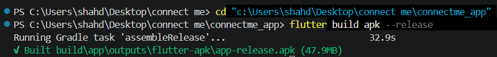
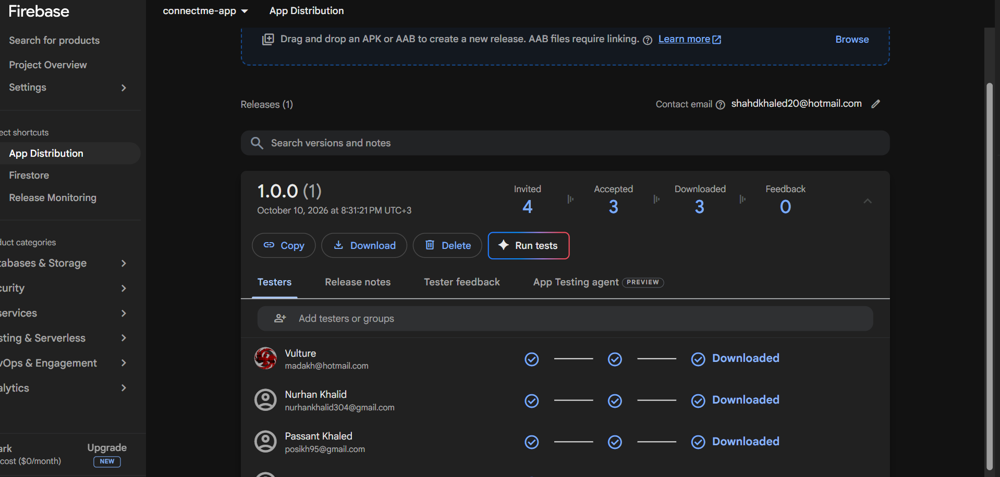
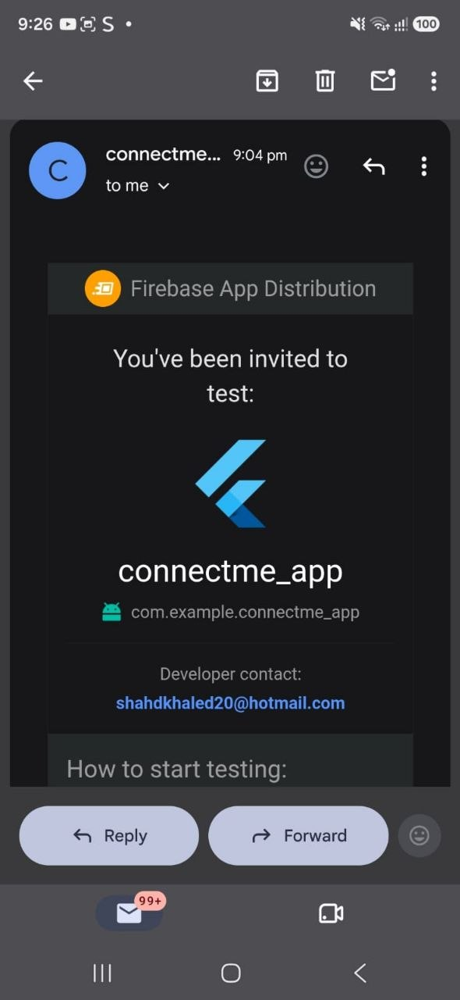
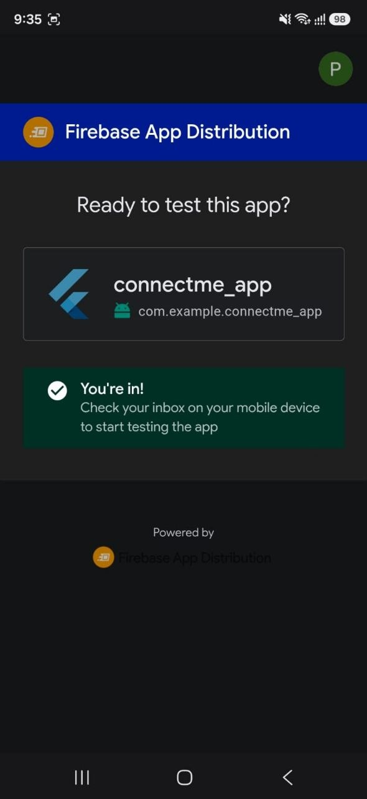
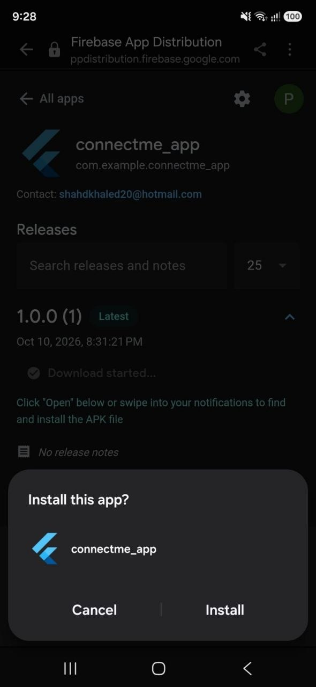

# ConnectMe Community App

Capstone Flutter app: Firebase Auth + Firestore, Clean Architecture, GetIt for dependency injection, and three design patterns applied deliberately rather than just for show.

## Setting up before you run it

### 1. Firebase project

```
flutterfire configure
```

Pick or create a Firebase project, select Android (and iOS if needed). This generates `lib/firebase_options.dart`, which isn't included here since it's specific to your own project.

In the [Firebase Console](https://console.firebase.google.com):
- **Authentication → Sign-in method** → enable **Email/Password**
- **Firestore Database** → create a database. Since posts and profiles are only readable/writable by signed-in users, set your rules to:
  ```
  rules_version = '2';
  service cloud.firestore {
    match /databases/{database}/documents {
      match /{document=**} {
        allow read, write: if request.auth != null;
      }
    }
  }
  ```

### 2. Google Maps API key

`google_maps_flutter` needs a key even for the free tier as of Google's current policy. If you can't set up billing, get a no-billing **Demo Key** instead at [mapsplatform.google.com/maps-demo-key](https://mapsplatform.google.com/maps-demo-key/), it covers Maps SDK for Android specifically, not just the web API.

Add it to `android/app/src/main/AndroidManifest.xml` inside `<application>`:
```xml
<meta-data
    android:name="com.google.android.geo.API_KEY"
    android:value="YOUR_KEY_HERE"/>
```

### 3. Biometric authentication (native changes)

Three changes needed for `local_auth`, none of which exist in a fresh `flutter create` project:

1. `android/app/src/main/kotlin/.../MainActivity.kt`:
   ```kotlin
   import io.flutter.embedding.android.FlutterFragmentActivity

   class MainActivity : FlutterFragmentActivity()
   ```
2. `android/app/build.gradle.kts`: set `minSdk = 23`
3. `AndroidManifest.xml`, outside `<application>`:
   ```xml
   <uses-permission android:name="android.permission.USE_BIOMETRIC"/>
   ```

You'll also need a fingerprint actually enrolled on your test device.

## Running it

```
flutter pub get
flutter run
```

## Architecture

Clean Architecture, three layers:

- **`domain/`** — pure Dart, no Firebase or Flutter imports. `Post` and `User` entities, `PostRepository` as an abstract contract, `GetPosts`/`CreatePost` as single-purpose use cases.
- **`data/`** — implements the domain contracts. `PostModel`/`UserModel` add `fromJson`/`toJson` on top of the entities. `PostRepositoryImpl` implements `PostRepository` by delegating to whichever `PostDataSource` the factory hands it.
- **`presentation/`** — `AuthCubit`, `PostCubit`, `ProfileCubit` and the screens/widgets that use them. Nothing here touches Firestore or Firebase Auth directly, everything goes through a service or a use case.

`injection.dart` is the single place every repository, use case, and Cubit gets registered with GetIt, screens ask GetIt for what they need instead of constructing dependencies themselves.

## Design patterns

- **Singleton** (`services/firestore_service.dart`) — `FirestoreService` has a private constructor, the only way to get one is through its static `instance`, so the whole app shares one Firestore wrapper.
- **Factory** (`data/datasources/post_datasource_factory.dart`) — `PostRepositoryImpl` never names `FirestorePostDataSource` or `LocalPostDataSource` directly, it asks the factory for a `PostDataSource` and gets back whichever one it needs.
- **Builder** (`domain/entities/user_builder.dart`) — `UserBuilder` sets a `User`'s fields one at a time. At sign-up, only `setFullName`/`setEmail` get called, so the built `User` has no photo or device info yet, those get added later from the profile screen without ever touching the fields that were already set.

## Permissions used

- `USE_BIOMETRIC` — required for the fingerprint prompt on the profile icon
- Internet access — required for Firebase and Google Maps, included by Flutter's default manifest
- Photo/media access — handled by the system Photo Picker on Android 13+, no manifest permission needed there

## A note on the profile photo

The task asks for the picked photo to be "uploaded to Firestore," and Firebase Storage isn't in this project's technology list, so the image is base64-encoded and stored as a string field on the user's Firestore document rather than uploaded to Cloud Storage. That's a reasonable approach for a small profile picture, it would not be the right call for large images in a real production app.

## Beta distribution (Firebase App Distribution)

This part happens after the app is built and can't be automated, here's the process:

1. Build a release APK:
   ```
   flutter build apk --release
   ```
   The output lands at `build/app/outputs/flutter-apk/app-release.apk`.
2. In the Firebase Console, open your project → **Release & Monitor → App Distribution**.
3. Click **Get started**, then **Upload** and select the APK above.
4. Under **Testers & Groups**, add at least two tester email addresses.
5. Add release notes (anything brief, e.g. "v1.0 beta") and click **Distribute**.
6. Both testers receive an email invitation with a link to install the Firebase App Tester app and download the build.

## Screenshots

### 1. Building the Release APK

The release APK was generated using Flutter.



### 2. Firebase App Distribution

The ConnectMe APK was uploaded to Firebase App Distribution.


### 3. Testers and Groups

Testers were added to Firebase App Distribution.



### 4. Tester Invitation Email

Firebase sent an invitation email to the tester.



### 5. Opening the Invitation

The tester opened the invitation link.



### 6. Installing ConnectMe

The tester accessed the release to install the app.



## Structure

Matches the Clean Architecture layout above, one file per screen, Cubit, use case, repository, model, and widget, as required.

## Notes

- Formatted with `dart format .`
- Ran `flutter analyze`, no issues
